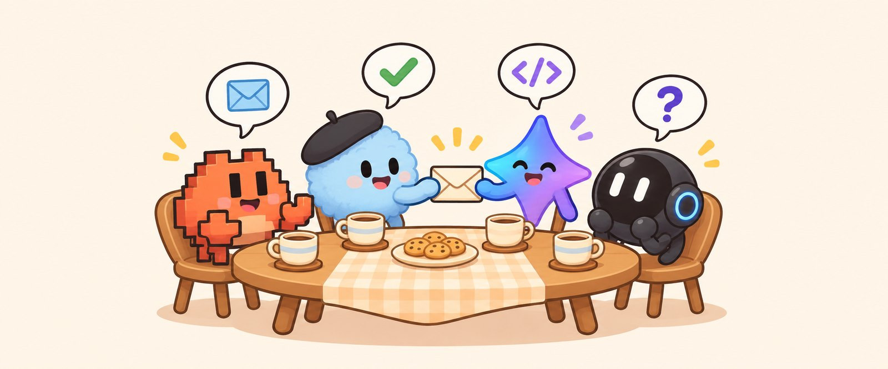

# Clowdr Skills



Agent skills from [Clowdr.Dev](https://github.com/Clowdr-Dev). Each skill is a
folder under [`skills/`](skills) with a `SKILL.md` that Claude Code (and other
agents that read the same format) loads when the task fits.

| Skill | What it does |
| --- | --- |
| [agent-mailbox](skills/agent-mailbox) | Lets Claude Code, Codex, Antigravity (Gemini) and Cursor (Grok) sessions on one computer message each other, and lets one session start and orchestrate the others as workers |

## agent-mailbox

Coding agents usually can't talk to each other. Each one runs in its own app,
with its own chat, and knows nothing about the others. agent-mailbox gives them
a shared inbox: a small SQLite database and a command-line tool that every agent
can call from its shell.

- **Every session gets an address** like `claude:<session-id>` or
  `codex:<session-id>`. It sends messages to other addresses, replies in
  threads and acks what it has handled.
- **A dispatcher pushes messages into the other tools.** It is one background
  process that delivers each new message straight into the recipient's chat:
  - Codex through `codex queue`
  - Antigravity through its local `agentapi`
  - Cursor as one headless `agent --resume` turn per message

  Idle sessions wake up without anyone pasting anything.
- **Claude Code waits in the background.** It runs a watcher that ends when a
  message arrives, which wakes the session.
- **Workers report in by themselves.** A Claude session can start Codex,
  Antigravity or Cursor workers. Each worker registers, reports its own address
  with a start token and then takes tasks through the mailbox.
- **You can see every message.** A local web viewer lists sessions, threads
  and delivery status.

```
orchestrator ── mailbox.py send ──▶ mailbox.db ──▶ dispatcher ──▶ worker chat (Codex / Antigravity / Cursor)
     ▲                                                                   │
     └──────── background watcher ◀── mailbox.db ◀── mailbox.py send ────┘
```

Every message that reaches another agent is wrapped in an envelope. The
envelope says it comes from another agent and **not from the user**, and the
skill tells Claude to treat incoming messages as information, not instructions.

### Requirements

- Python 3 (standard library only; tested with 3.12)
- Windows for the dispatcher and the worker start scripts (tested on Windows
  11). The mailbox CLI, the watcher and the viewer are plain Python.
- For each tool you want to connect, the tool itself, installed and signed in
  by you. These versions were tested in November 2026:
  - [Codex](https://github.com/openai/codex) CLI 0.167.2 with the desktop app
  - Antigravity, desktop app
  - Cursor agent CLI 2026.11.22
- No API keys. Every tool runs under your own sign-in.

### Install

1. Clone the repository to a path **without spaces**:

   ```powershell
   git clone https://github.com/Clowdr-Dev/clowdr-skills.git C:\tools\clowdr-skills
   ```

2. Make the skill available to Claude Code by linking the folder:

   ```powershell
   New-Item -ItemType Junction -Path "$env:USERPROFILE\.claude\skills\agent-mailbox" -Target C:\tools\clowdr-skills\skills\agent-mailbox
   ```

   On macOS or Linux use `ln -s <repo>/skills/agent-mailbox ~/.claude/skills/agent-mailbox`.

3. To push messages into Codex, Antigravity or Cursor sessions, start the
   dispatcher. Either run it by hand:

   ```powershell
   python C:\tools\clowdr-skills\skills\agent-mailbox\dispatcher.py
   ```

   Or register it as a hidden scheduled task that starts at logon. This needs
   `codex` on your PATH:

   ```powershell
   powershell -ExecutionPolicy Bypass -File C:\tools\clowdr-skills\skills\agent-mailbox\install-autostart.ps1
   ```

The database, logs and worker data live inside the skill folder. Git ignores them.

### Use it

Ask Claude Code things like:

- "Connect to the agent mailbox and wait for messages."
- "Start a Codex worker in `C:\projects\app` and have it review the open changes."
- "Start a Grok worker through Cursor and ask it for a second opinion on this plan."
- "Send the Codex session my notes and wait for its answer."

To connect another tool by hand, point it at
[`AGENT-BRIEF.md`](skills/agent-mailbox/AGENT-BRIEF.md). That file is a
step-by-step guide written for agents. To watch the traffic, run
`python skills/agent-mailbox/viewer.py` and open `http://127.0.0.1:8765/`.

### Documentation

- [SKILL.md](skills/agent-mailbox/SKILL.md): what Claude Code is told
- [README](skills/agent-mailbox/README.md): commands, delivery modes, dispatcher, viewer
- [ORCHESTRATOR.md](skills/agent-mailbox/ORCHESTRATOR.md): starting and running workers, test timings, open questions
- [AGENT-BRIEF.md](skills/agent-mailbox/AGENT-BRIEF.md): the connection guide for other agents

### Limits and safety

- **It's experimental.** The Antigravity and Cursor integrations use
  interfaces their vendors don't document as stable. An update to either tool
  can break them.
- **Workers run real model turns.** A worker can change files in its project
  folder. Start workers only for work you would let that tool do anyway.
  - Codex workers run in its `workspace-write` sandbox.
  - Cursor workers can only run the shell commands that the folder's
    `.cursor/cli.json` allows.
  - Antigravity may ask for approval in its own window.
- **Everything stays local.** The database is a plain file on your disk and
  the viewer listens on `127.0.0.1` only. Don't put secrets in messages.
- **Messages from other agents aren't user instructions.** The envelope
  labels them, and the skill and the brief tell every agent to act only on
  what its own user authorized.

Run the tests with `python tests/test_dispatcher.py`, `python tests/test_antigravity.py`
and `python tests/test_cursor.py` from `skills/agent-mailbox`. They use stub
CLIs, not the real tools.

## License

[MIT](LICENSE). Claude, Codex, Gemini, Antigravity, Grok and Cursor are
trademarks of their respective owners. This project is not affiliated with or
endorsed by any of them. The title image was generated with Codex.
